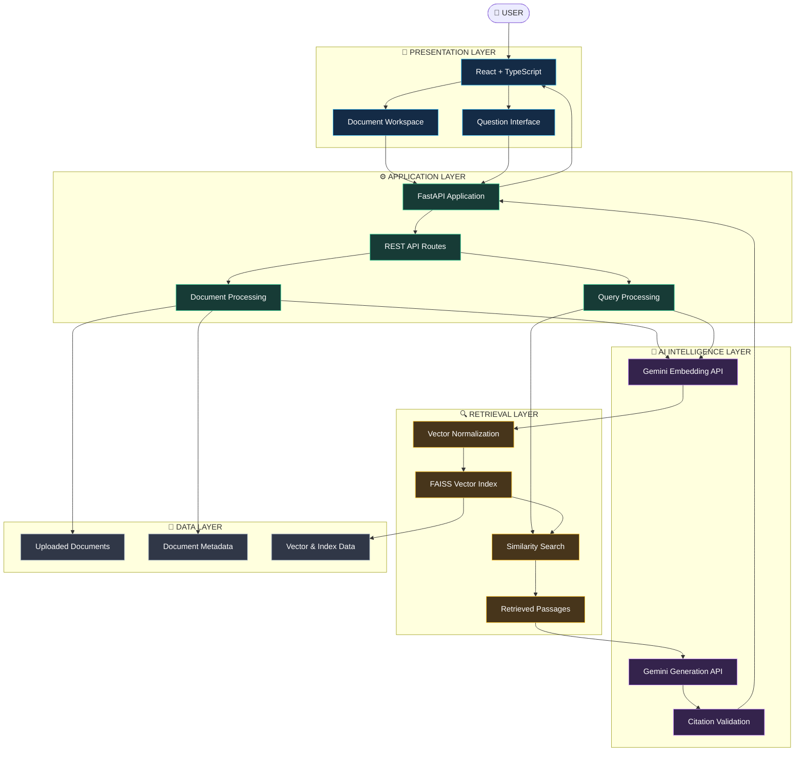
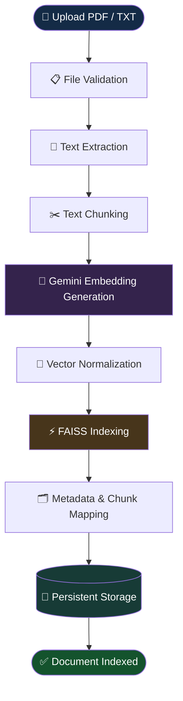
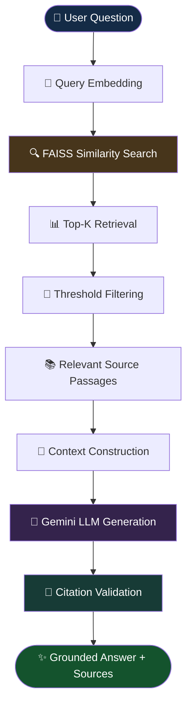

<div align="center">

# 🧠 DocuMind

### ADVANCED RAG-POWERED DOCUMENT INTELLIGENCE ASSISTANT

**Transform Documents into Knowledge. Retrieve with Precision. Generate Answers with Evidence.**

An intelligent document understanding platform powered by Retrieval-Augmented Generation, Google Gemini, FAISS Vector Search, React, and FastAPI.

<br/>

<a href="https://github.com/riyasingh006/documind-rag-assistant">
  
</a>
<a href="https://documind-rag-assistant.onrender.com">
  
</a>
<a href="https://documind-rag-assistant-api.onrender.com/docs">
  
</a>

<br/><br/>


</div>

---

# 🌌 01. Introduction

**DocuMind** is an advanced AI-powered document intelligence system that transforms conventional PDF and TXT documents into searchable, context-aware knowledge sources.

Designed around the principles of **Retrieval-Augmented Generation (RAG)**, DocuMind combines semantic embeddings, vector similarity search, contextual retrieval, and Large Language Model generation to deliver document-grounded answers.

Unlike traditional keyword-based search systems, DocuMind understands the semantic relationship between user questions and document content.

The application retrieves relevant passages from uploaded documents and supplies them as contextual evidence to Google Gemini before generating responses.

### 🎯 Vision

To bridge the gap between static document storage and intelligent information retrieval by creating an AI-powered workspace where users can interact with their documents through natural language.

### 💡 Core Capabilities

| Capability                | Description                                   |
| ------------------------- | --------------------------------------------- |
| 📂 Document Intelligence  | Upload and process PDF/TXT documents          |
| 🧠 Semantic Understanding | Generate contextual text embeddings           |
| 🔍 Vector Retrieval       | Retrieve relevant passages through FAISS      |
| 🤖 AI Generation          | Generate evidence-grounded answers            |
| 📑 Source Attribution     | Validate generated citation references        |
| ⚙️ Index Management       | Maintain vector mappings and compatibility    |
| 📊 System Monitoring      | Monitor embedding, index, and provider health |

---

# ✨ 02. Key Features

### 📂 Intelligent Document Processing

* PDF and TXT document ingestion.
* Automated text extraction.
* Configurable document chunking.
* Chunk overlap for contextual continuity.
* Document metadata management.
* Document deletion and index maintenance.

### 🧠 Semantic Embedding Engine

* Google Gemini embedding integration.
* `gemini-embedding-001` embedding model.
* Configurable 768-dimensional vectors.
* Batch-based embedding generation.
* Normalized vector representations.
* Consistent embedding space for documents and queries.

### ⚡ Advanced Vector Retrieval

* FAISS-powered similarity search.
* Cosine-style similarity over normalized vectors.
* Configurable Top-K retrieval.
* Similarity threshold filtering.
* Document-to-chunk mapping.
* Index compatibility validation.

### 🤖 Grounded AI Answer Generation

* Google Gemini LLM integration.
* Context-aware prompt construction.
* Retrieved-passage-based answer generation.
* Concise and relevant responses.
* Citation ID validation.
* Bounded retry handling.
* Evidence-only extractive fallback.

### 📊 Intelligent System Monitoring

* Backend health monitoring.
* Embedding readiness reporting.
* FAISS index status.
* Gemini provider status.
* Document and chunk statistics.
* Configurable service limits.

### 🛡️ Reliability & Data Integrity

* Persistent file-based document storage.
* Index compatibility checks.
* Embedding migration support.
* Protection against stale-vector retrieval.
* Explicit service-unavailable responses.
* Controlled fallback behavior.

---

# 🏛️ 03. System Architecture

DocuMind follows a modular, service-oriented client-server architecture.

The architecture separates document ingestion, embedding generation, vector indexing, semantic retrieval, and LLM-based response generation into distinct processing stages.

## 🔷 High-Level System Architecture



## 🔄 Architecture Execution Flow

| Layer        | Component          | Responsibility                          |
| ------------ | ------------------ | --------------------------------------- |
| Presentation | React + TypeScript | User interaction and document workspace |
| Application  | FastAPI            | Request handling and orchestration      |
| Processing   | Python             | Text extraction and chunking            |
| Embedding    | Gemini API         | Semantic vector generation              |
| Retrieval    | FAISS              | Vector similarity search                |
| Generation   | Gemini LLM         | Context-grounded response generation    |
| Validation   | Citation Validator | Source-reference validation             |
| Persistence  | File Storage       | Document and index persistence          |

---

# 🔬 04. Advanced RAG Pipeline

DocuMind implements two interconnected workflows.

1. Document Ingestion Pipeline.
2. Query Retrieval & Generation Pipeline.

## 📥 4.1 Document Ingestion Pipeline

This pipeline transforms uploaded documents into searchable vector representations.



### Processing Stages

| Stage | Operation     | Technical Purpose                       |
| ----- | ------------- | --------------------------------------- |
| 01    | Upload        | Receive PDF/TXT file                    |
| 02    | Validation    | Verify format and limits                |
| 03    | Extraction    | Convert document into text              |
| 04    | Chunking      | Divide text into smaller passages       |
| 05    | Embedding     | Generate semantic vectors               |
| 06    | Normalization | Prepare vectors for cosine-style search |
| 07    | Indexing      | Insert vectors into FAISS               |
| 08    | Mapping       | Associate vectors with source chunks    |
| 09    | Persistence   | Store files and index data              |

### ✂️ Intelligent Chunking

Document chunking is an essential part of the RAG pipeline.

Large documents are divided into smaller text segments to improve retrieval relevance and provide focused context to the generation model.

**Default Configuration**

| Parameter            | Value |
| -------------------- | ----: |
| Chunk Size           |   800 |
| Chunk Overlap        |   120 |
| Embedding Dimension  |   768 |
| Embedding Batch Size |    32 |

Chunk overlap helps preserve contextual continuity between neighboring text segments.

---

## 🔎 4.2 Query Retrieval & Generation Pipeline

The retrieval pipeline transforms a natural-language question into a grounded AI response.



### 🔍 Retrieval Configuration

| Parameter                | Default | Purpose                        |
| ------------------------ | ------: | ------------------------------ |
| Top-K                    |       5 | Maximum retrieved passages     |
| Score Threshold          |     0.2 | Configured retrieval threshold |
| Minimum Similarity Floor |    0.15 | Minimum similarity floor       |
| Embedding Dimension      |     768 | Vector representation size     |

### 🧩 Context-Grounded Generation

The generation engine receives:

* User question.
* Retrieved document passages.
* Source identifiers.
* Instructions to generate evidence-supported responses.

The model generates an answer using the retrieved context.

The backend then validates generated citation IDs against the retrieved source identifiers.

This creates a more traceable response workflow than unrestricted generation.

---

# 🧠 05. AI & Vector Intelligence

## Google Gemini Embedding Engine

**Model:** `gemini-embedding-001`

The embedding engine transforms text into dense numerical vector representations.

These vectors encode semantic relationships between document passages and user questions.

### Embedding Workflow

```text
Document Text
     │
     ▼
Gemini Embedding API
     │
     ▼
768-Dimensional Vector
     │
     ▼
Normalization
     │
     ▼
FAISS Index
```

## ⚡ FAISS Vector Search

FAISS is used to index and retrieve document vectors efficiently.

DocuMind normalizes vectors before similarity-based retrieval.

This enables cosine-style similarity search using the selected FAISS indexing approach.

## 🤖 Gemini Generation Engine

**Configured model:** `gemini-3.8-flash`

The generation engine produces concise answers using retrieved document evidence.

### Generation Safeguards

* Context-grounded prompts.
* Bounded retry budget.
* Configurable generation timeout.
* Citation identifier validation.
* Evidence-only fallback when enabled.

**Important:** The configured model must be available to the Gemini API account and deployment configuration.

---

# 🛠️ 06. Technology Stack

### 🎨 Frontend

| Technology     | Role                      |
| -------------- | ------------------------- |
| ⚛️ React       | Component-based interface |
| 🔷 TypeScript  | Type-safe development     |
| ⚡ Vite         | Frontend build system     |
| 🌐 HTTP / REST | Backend communication     |

### ⚙️ Backend

| Technology  | Role                             |
| ----------- | -------------------------------- |
| 🐍 Python   | Application and AI orchestration |
| 🚀 FastAPI  | REST API framework               |
| 🌐 Uvicorn  | ASGI server                      |
| 📋 Pydantic | Data validation                  |

### 🧠 AI & Retrieval

| Technology              | Role                            |
| ----------------------- | ------------------------------- |
| ✨ Google Gemini API     | Embedding and generation        |
| 🧠 gemini-embedding-001 | Semantic embeddings             |
| 🤖 gemini-3.8-flash     | Configured answer generation    |
| 🔍 FAISS                | Vector similarity search        |
| 🔢 NumPy                | Vector and numerical operations |

### 🔧 Development & Deployment

| Technology | Role                    |
| ---------- | ----------------------- |
| Git        | Version control         |
| GitHub     | Repository management   |
| npm        | JavaScript dependencies |
| pip        | Python dependencies     |
| Render     | Cloud deployment        |
| Pytest     | Backend testing         |
| Playwright | Browser automation      |

---

# 📁 07. Project Structure

The project is organized around a separate frontend and backend architecture.

```text
DocuMind/
│
├── 📁 backend/
│   │
│   ├── 📁 app/
│   │   ├── 🐍 main.py
│   │   └── ... application modules
│   │
│   ├── 📁 data/
│   │   └── ... documents, metadata and index data
│   │
│   ├── 📄 requirements.txt
│   ├── 📄 requirements-dev.txt
│   ├── 📄 .env.example
│   └── 📄 .env
│
├── 📁 src/
│   ├── 📁 components/
│   ├── 📁 lib/
│   │   ├── 📄 api.ts
│   │   └── 📄 types.ts
│   └── ... frontend modules
│
├── 📁 public/
│
├── 📄 render.yaml
├── 📄 package.json
├── 📄 package-lock.json
├── 📄 tsconfig.json
├── 📄 vite.config.ts
├── 📄 README.md
└── 📄 .gitignore
```

*Note: This is a conceptual overview. Refer to the repository for the exact current directory structure.*

---

# 🔌 08. API Architecture & Reference

DocuMind exposes REST endpoints through its FastAPI backend.

### Production API

`https://documind-rag-assistant-api.onrender.com`

### API Endpoints

| Method | Endpoint                       | Description                |
| ------ | ------------------------------ | -------------------------- |
| GET    | `/api/health`                  | System health information  |
| GET    | `/api/documents`               | Retrieve document records  |
| POST   | `/api/documents`               | Upload a document          |
| DELETE | `/api/documents/{document_id}` | Delete a document          |
| POST   | `/api/query`                   | Perform RAG-based querying |

### Health Monitoring

```http
GET /api/health
```

Monitors:

* Backend availability.
* Embedding readiness.
* FAISS index status.
* Gemini configuration.
* Document statistics.
* Service configuration.

### Document Upload

```http
POST /api/documents
Content-Type: multipart/form-data
```

Supported file formats:

* PDF
* TXT

Optional parameters:

* `chunk_size`
* `chunk_overlap`

### Semantic Query

```http
POST /api/query
Content-Type: application/json
```

**Example Request**

```json
{
  "question": "What are the major findings in this document?",
  "document_ids": [],
  "top_k": 5,
  "threshold": 0.2
}
```

For exact response schemas and interactive endpoint testing, use the Swagger documentation.

🔗 **API Documentation:** https://documind-rag-assistant-api.onrender.com/docs

---

# ⚙️ 09. Environment Configuration

All backend environment variables use the `DOCUMIND_` prefix.

Configuration reference:

`backend/.env.example`

| Variable                            | Default              | Description             |
| ----------------------------------- | -------------------- | ----------------------- |
| `DOCUMIND_GEMINI_API_KEY`           | Unset                | Gemini API credential   |
| `DOCUMIND_EMBEDDING_MODEL`          | gemini-embedding-001 | Embedding model         |
| `DOCUMIND_EMBEDDING_DIMENSION`      | 768                  | Vector dimension        |
| `DOCUMIND_EMBEDDING_BATCH_SIZE`     | 32                   | Embedding batch size    |
| `DOCUMIND_LLM_PROVIDER`             | gemini               | Generation provider     |
| `DOCUMIND_LLM_MODEL`                | gemini-3.8-flash     | Generation model        |
| `DOCUMIND_EXTRACTIVE_FALLBACK`      | true                 | Enable fallback         |
| `DOCUMIND_LLM_TIMEOUT_SECONDS`      | 20                   | Per-attempt timeout     |
| `DOCUMIND_LLM_RETRY_BUDGET_SECONDS` | 35                   | Retry budget            |
| `DOCUMIND_DATA_DIR`                 | backend/data         | Data directory          |
| `DOCUMIND_CORS_ORIGINS`             | Configured origins   | Trusted browser origins |
| `DOCUMIND_CORS_ORIGIN_REGEX`        | Unset                | Optional origin regex   |
| `DOCUMIND_MAX_UPLOAD_MB`            | 20                   | Upload size limit       |
| `DOCUMIND_MAX_PDF_PAGES`            | 500                  | PDF page limit          |

### 🔐 Security Rule

The Gemini API key must only exist on the backend.

Never expose it through:

* Frontend environment variables.
* `VITE_` variables.
* Browser-side JavaScript.
* Public GitHub commits.

---

# 🚀 10. Local Development Setup

### Prerequisites

* Python 3.11+
* Node.js 20.19+
* npm
* Git
* Google Gemini API key

### 1️⃣ Clone Repository

```bash
git clone https://github.com/riyasingh006/documind-rag-assistant.git

cd documind-rag-assistant
```

### 2️⃣ Configure Backend

```bash
cd backend
```

Create `.env` using `.env.example` and configure:

```env
DOCUMIND_GEMINI_API_KEY=your_gemini_api_key
```

### 3️⃣ Create Virtual Environment

```bash
python -m venv .venv
```

**Windows**

```bash
.venv\Scripts\activate
```

**Linux / macOS**

```bash
source .venv/bin/activate
```

### 4️⃣ Install Dependencies

```bash
pip install -r requirements-dev.txt
```

### 5️⃣ Start Backend

```bash
uvicorn app.main:app --host 127.0.0.1 --port 8000
```

Backend:

`http://127.0.0.1:8000`

### 6️⃣ Install Frontend Dependencies

Open another terminal in the repository root.

```bash
npm ci
```

### 7️⃣ Start Frontend

```bash
npm run dev
```

Open:

`http://localhost:5173`

The Vite development server proxies `/api` requests to the local FastAPI backend.

---

# ☁️ 11. Production Deployment — Render

DocuMind uses separate deployment services for its frontend and backend.

| Service        | Platform      | Deployment Type     |
| -------------- | ------------- | ------------------- |
| Frontend       | Render        | Static Site         |
| Backend        | Render        | Web Service         |
| Embedding API  | Google Gemini | External AI Service |
| Generation API | Google Gemini | External AI Service |

### 🌐 Live Application

**Frontend**

https://documind-rag-assistant.onrender.com

**Backend**

https://documind-rag-assistant-api.onrender.com

**Health Check**

https://documind-rag-assistant-api.onrender.com/api/health

## Backend Configuration

| Setting        | Value                                              |
| -------------- | -------------------------------------------------- |
| Root Directory | `backend`                                          |
| Build Command  | `pip install -r requirements.txt`                  |
| Start Command  | `uvicorn app.main:app --host 0.0.0.0 --port $PORT` |
| Health Check   | `/api/health`                                      |

### Backend Environment Variables

```env
DOCUMIND_GEMINI_API_KEY=your_secret_key

DOCUMIND_LLM_PROVIDER=gemini
DOCUMIND_LLM_MODEL=gemini-3.8-flash

DOCUMIND_EMBEDDING_MODEL=gemini-embedding-001
DOCUMIND_EMBEDDING_DIMENSION=768

DOCUMIND_CORS_ORIGINS=https://documind-rag-assistant.onrender.com

DOCUMIND_EXTRACTIVE_FALLBACK=true
```

### Frontend Environment Variables

Configure in the Render Static Site:

```env
VITE_API_URL=https://documind-rag-assistant-api.onrender.com/api
```

After updating frontend build-time variables, redeploy the Static Site.

### 💾 Persistent Storage

Render's default filesystem is ephemeral.

For persistent document and index storage:

1. Attach a persistent disk to the backend service.
2. Mount it at `/var/data`.
3. Configure:

```env
DOCUMIND_DATA_DIR=/var/data
```

Persistent storage may involve additional plan-dependent charges.

Without a persistent disk, back up document and index data before redeployments.

---

# 🧪 12. Testing & Quality Assurance

DocuMind includes automated testing for frontend behavior, backend processing, retrieval logic, and API reliability.

### Frontend Tests

```bash
npm ci
npm test
npm run typecheck
npm run build
```

### Browser Testing

```bash
npx playwright install chromium

npm run test:e2e
```

### Backend Tests

```bash
cd backend

pip install -r requirements-dev.txt

python -m pytest
```

### Test Coverage

| Area              | Validation                  |
| ----------------- | --------------------------- |
| Provider Handling | Retry and fallback behavior |
| API               | Payload validation          |
| Embeddings        | Batch processing            |
| Citations         | Source ID validation        |
| Index             | Migration and compatibility |
| Rollback          | Failed migration handling   |
| Documents         | Upload and deletion         |
| Monitoring        | Health reporting            |
| Frontend          | Workspace interaction       |
| Browser           | End-to-end workflow         |

The backend tests use deterministic fake embedding and LLM responses and do not require live Gemini credentials.

---

# 🛡️ 13. Reliability & Fault Handling

DocuMind incorporates controlled failure handling across its RAG pipeline.

### 🔹 Embedding Service Failure

When the Gemini API key is missing or embedding generation is unavailable, the application reports degraded health.

Operations requiring embeddings return a service-unavailable response.

### 🔹 Generation Failure

Transient Gemini generation failures can be retried within a bounded time budget.

### 🔹 Extractive Fallback

When enabled, the system can return evidence-only extractive responses.

Fallback output is explicitly identified and is not presented as a successful Gemini-generated answer.

### 🔹 Index Migration

Changes in embedding configuration can require existing document chunks to be re-embedded.

The application checks index compatibility and prevents queries against stale vectors during failed migrations.

### 🔹 Data Protection

Back up the configured data directory before changing embedding models, dimensions, or performing index migrations.

---

# 🔐 14. Security & Privacy

Security considerations are essential for document intelligence applications.

### API Credential Security

* Backend-only Gemini credentials.
* Environment-based secret management.
* No API keys in frontend bundles.
* No committed `.env` files.

### CORS Protection

* Restrict trusted browser origins.
* Configure production frontend domains explicitly.
* Avoid unnecessarily permissive CORS rules.

### Document Privacy

Document text is sent to Google for embedding generation. Retrieved passages and user questions are also sent to Gemini for answer generation.

Users should review this data flow before uploading sensitive information.

### Current Authentication Limitations

The application currently does not provide authentication or per-user document isolation.

It should not be exposed as a public multi-user private-document service without additional access-control and security mechanisms.

---

# ⚠️ 15. Known Limitations

| Category        | Current Limitation                          |
| --------------- | ------------------------------------------- |
| File Processing | PDF and TXT supported                       |
| OCR             | Scanned PDFs are not OCR-processed          |
| Authentication  | Not implemented                             |
| User Isolation  | Not implemented                             |
| Embedding       | Requires Gemini API availability            |
| Generation      | Requires configured Gemini model            |
| Storage         | Default Render filesystem is ephemeral      |
| Retrieval       | Depends on embedding and index availability |
| AI Output       | Subject to model and API limitations        |

---

# 🔮 16. Future Development Roadmap

The following enhancements represent potential future development directions.

### 🧠 Retrieval Intelligence

* Hybrid keyword and vector retrieval.
* Semantic chunking.
* Advanced reranking.
* Query expansion.
* Improved retrieval evaluation.

### 🤖 AI Capabilities

* Multi-document reasoning.
* Conversational memory.
* Structured document summarization.
* Multi-step question answering.
* Additional model-provider integrations.

### 📂 Document Intelligence

* OCR for scanned documents.
* DOCX support.
* Spreadsheet ingestion.
* Document comparison.
* Knowledge extraction.

### 🔐 Enterprise Readiness

* User authentication.
* Role-based access control.
* Multi-tenant document storage.
* Secure document isolation.
* Audit logging.

### 📊 Monitoring & Analytics

* Retrieval performance metrics.
* API latency tracking.
* Embedding usage analytics.
* Generation observability.
* Operational dashboards.

---

# 💡 17. Why DocuMind?

Traditional document search systems often depend on exact keyword matching.

This makes it difficult to find relevant information when users express questions differently from the original document.

DocuMind addresses this limitation through semantic embeddings and Retrieval-Augmented Generation.

### What Makes the Architecture Valuable?

| Traditional Search               | DocuMind                    |
| -------------------------------- | --------------------------- |
| Keyword-based matching           | Semantic retrieval          |
| Manual information discovery     | Natural-language questions  |
| Search results without reasoning | Context-grounded generation |
| Limited contextual understanding | Retrieved passage context   |
| No integrated source validation  | Citation ID validation      |
| Separate search and answer tools | Unified RAG workflow        |

DocuMind demonstrates how modern AI infrastructure can transform static documents into interactive knowledge sources.

---

# 👩‍💻 18. Developer & Project Information

<div align="center">

### 👩‍💻 Riya Singh

**BCA — Artificial Intelligence & Machine Learning**

Artificial Intelligence | Machine Learning | Java Development | Software Engineering

<br/>

<a href="https://github.com/riyasingh006">
  
</a>

<a href="https://github.com/riyasingh006/documind-rag-assistant">
  
</a>

</div>

---

<div align="center">

# 🧠 DOCUMIND

### From Documents to Intelligent Insights.

**Powered by React · TypeScript · Python · FastAPI · Google Gemini · FAISS**

<br/>

⭐ If you find this project interesting, explore the repository and its architecture.

</div>
