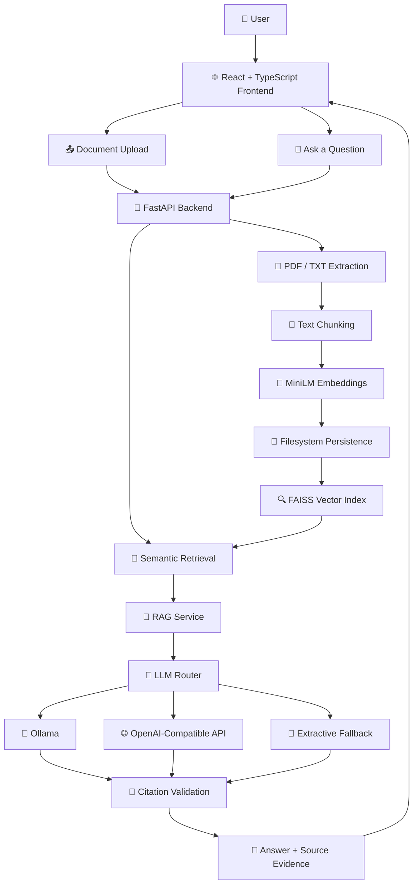

<div align="center">

# 📚 DocuMind AI

### 🧠 Intelligent Document Question Answering System

**💬 Ask Questions · 🔍 Retrieve Evidence · 📑 Get Source-Grounded Answers**

Transform your documents into an interactive knowledge base using **Retrieval-Augmented Generation (RAG), Semantic Search, Vector Embeddings, and Large Language Models.**

[](https://react.dev/)
[](https://www.typescriptlang.org/)
[](https://fastapi.tiangolo.com/)
[](https://www.python.org/)
[](https://github.com/facebookresearch/faiss)

<br/>

**🚀 From Raw Documents to Intelligent Answers — Powered by RAG**

📄 PDF & TXT Support · 🧠 Local Embeddings · 🔎 Semantic Retrieval · 📌 Source Citations

<br/>

[✨ Features](#-key-features) •
[🏗️ Architecture](#️-system-architecture) •
[🔬 RAG Pipeline](#-rag-pipeline) •
[⚙️ Installation](#️-installation-and-setup) •
[🔌 API](#-api-reference)

</div>

---

## 🌟 About The Project

**DocuMind AI** is a full-stack, document-based question-answering application that enables users to interact with their documents through natural language.

Instead of manually searching through lengthy PDFs or text files, users can upload their documents, ask questions, and receive answers grounded in relevant document passages.

The application combines a modern React frontend with a FastAPI backend, local semantic embeddings, FAISS vector search, and configurable answer-generation providers.

Its Retrieval-Augmented Generation architecture helps connect language-model responses with evidence retrieved from the user's own documents.

### 💡 What Makes DocuMind AI Special?

* 🧠 **Semantic Understanding:** Finds relevant passages based on meaning, not only exact keywords.
* 📚 **Document Intelligence:** Converts uploaded documents into searchable knowledge.
* 🔍 **Evidence-Based Retrieval:** Retrieves relevant chunks before generating answers.
* 📌 **Source-Aware Responses:** Displays retrieved passages and validates citation identifiers.
* 🖥️ **Local-First Embeddings:** Generates document and question embeddings locally by default.
* 🔄 **Flexible AI Generation:** Supports optional Ollama, OpenAI-compatible providers, and extractive fallback.
* ⚡ **Modern Full-Stack Architecture:** Separates the user interface, API, retrieval engine, and generation logic.

---

## 🎯 Problem Statement

Working with lengthy documents can make it difficult to locate specific information quickly. Traditional keyword searches may miss relevant content when the user's wording differs from the text.

Additionally, a language model can produce unsupported information when it answers without appropriate evidence.

DocuMind AI addresses these challenges by combining semantic retrieval with document-grounded question answering.

### 🎯 Project Objectives

* 📄 Simplify document upload and processing.
* 🧩 Break lengthy documents into manageable text chunks.
* 🧠 Generate semantic vector embeddings.
* 🔎 Retrieve relevant passages using similarity search.
* 💬 Generate answers using retrieved evidence.
* 📌 Provide source references to support answer inspection.
* 🛡️ Handle missing evidence and unavailable generation providers gracefully.

---

## ✨ Key Features

### 📂 1. Intelligent Document Processing

* Upload PDF and TXT documents.
* Validate file extensions, sizes, and document content.
* Extract PDF text page by page using PyMuPDF.
* Decode supported UTF-8, UTF-16, and CP1252 text files.
* Preserve page metadata for source attribution.
* Configure chunk size and overlap during ingestion.

### 🧠 2. Semantic Embedding Generation

DocuMind AI uses the `sentence-transformers/all-MiniLM-L6-v2` embedding model.

* 🔢 Generates 384-dimensional vectors with the default model.
* 💻 Performs embedding inference locally by default.
* 🧩 Supports overlapping model windows for long chunks.
* 📐 Normalizes vectors for similarity-based retrieval.

### 🔍 3. FAISS-Powered Vector Search

The application uses **FAISS IndexFlatIP** for exact inner-product search over normalized vectors.

Features include:

* 🎯 Similarity-based candidate retrieval.
* 🧹 Duplicate parent-chunk filtering.
* 📊 Absolute and relative similarity cutoffs.
* 🔢 Configurable top-K retrieval.
* 📚 Search across all documents or selected documents.

### 💬 4. Retrieval-Augmented Generation

The RAG engine retrieves relevant document passages and uses them to construct the context for answering a question.

Supported generation modes include:

* 🦙 **Ollama:** Optional local LLM inference.
* 🌐 **OpenAI-Compatible API:** Optional compatible generation endpoint.
* 📝 **Extractive Fallback:** Extracts relevant sentences from retrieved evidence when enabled.

The default local embedding and extractive-answering workflow does not require a paid LLM API key.

### 📌 5. Source Evidence and Citation Validation

* 🔢 Numbered source passages.
* 📄 Source filenames and page information.
* 📊 Retrieval similarity information.
* 🔗 Inline citation markers such as `[1]`.
* ✅ Validation of citation identifiers against available sources.
* 📚 Distinction between cited and retrieved-only sources.

> ⚠️ Citation validation checks whether a citation refers to a supplied source. It does not independently verify every factual claim.

### 🗂️ 6. Document Library Management

* 📋 Browse indexed documents.
* 🔎 Search the document library.
* 🏷️ Filter documents by file type.
* 🗑️ Delete documents and their associated vectors.
* 🔄 Reload persisted document data after backend restarts.

### ⚙️ 7. Configurable Workspace

* 🎛️ Retrieval settings with browser-side persistence.
* 💬 Session-scoped chat history.
* ❤️ Backend health and LLM provider status.
* ⏳ Loading and progress states.
* 🚫 Empty, offline, error, and insufficient-evidence states.
* 📱 Responsive landing page and workspace.
* ♿ Accessibility features including ARIA labels, keyboard-focus management, skip links, and reduced-motion handling.

---

## 🛠️ Technology Stack

| Category                  | Technologies                        |
| ------------------------- | ----------------------------------- |
| 🎨 Frontend               | React 18, TypeScript 5              |
| ⚡ Build Tool              | Vite 6                              |
| 🧭 Routing                | React Router DOM 6                  |
| 🎨 Styling                | Tailwind CSS 3, PostCSS, Custom CSS |
| 🧩 UI Utilities           | Lucide React, clsx, tailwind-merge  |
| 🐍 Backend                | Python, FastAPI                     |
| 🚀 API Server             | Uvicorn                             |
| ✅ Validation              | Pydantic v2                         |
| 🧠 Embeddings             | Sentence Transformers               |
| 📦 Embedding Model        | `all-MiniLM-L6-v2`                  |
| 🔍 Vector Database/Search | FAISS CPU                           |
| 🔢 Numerical Processing   | NumPy                               |
| 📄 PDF Extraction         | PyMuPDF                             |
| 🤖 Local LLM Runtime      | Ollama — Optional                   |
| 🌐 LLM Integration        | OpenAI-Compatible API — Optional    |
| 💾 Persistence            | Filesystem, JSON, NumPy arrays      |
| 🧪 Backend Testing        | pytest                              |
| 🧪 Frontend Testing       | Vitest, Testing Library, jsdom      |
| 🎭 Browser Testing        | Playwright                          |

---

## 🏗️ System Architecture

DocuMind AI follows a modular frontend-backend architecture.

The frontend communicates with FastAPI through HTTP requests. The backend handles ingestion, embedding generation, vector storage, semantic retrieval, prompt construction, generation-provider selection, and response formatting.

### 🔄 Architecture Diagram



### 🧱 Architectural Components

| Component              | Responsibility                                                       |
| ---------------------- | -------------------------------------------------------------------- |
| ⚛️ React Frontend      | User interaction, document library, and question-answering workspace |
| 🚀 FastAPI             | HTTP endpoints and request orchestration                             |
| 📄 Extraction Module   | PDF/TXT content extraction                                           |
| 🧩 Chunking Module     | Text normalization and chunk creation                                |
| 🧠 Embedding Service   | Converts text into numerical vectors                                 |
| 💾 Document Store      | Persists document metadata and vectors                               |
| 🔍 FAISS               | Finds semantically similar chunks                                    |
| 🧠 RAG Service         | Filters retrieval results and constructs context                     |
| 🤖 LLM Router          | Selects a generation provider or fallback                            |
| 📌 Citation Processing | Validates citation identifiers and formats source metadata           |

---

## 🔬 RAG Pipeline

The core of DocuMind AI is its **Retrieval-Augmented Generation pipeline**.

### 📍 Step 1 — Upload

**Module:** `backend/app/main.py`

The user uploads a PDF or TXT document through the frontend.

The backend validates the file and accepts it through:

`POST /api/documents`

### 📍 Step 2 — Extract Text

**Module:** `backend/app/extraction.py`

* 📄 PDF text is extracted page by page using PyMuPDF.
* 📝 TXT content is decoded using supported encodings.
* 📑 Page metadata is preserved.
* 🛑 Unsupported, encrypted, or image-only PDF inputs are rejected.

### 📍 Step 3 — Normalize and Chunk

**Module:** `backend/app/chunking.py`

The extracted content is normalized and divided into overlapping chunks.

Each page is chunked independently, helping preserve page-level source information.

### 📍 Step 4 — Generate Embeddings

**Module:** `backend/app/embeddings.py`

The Sentence Transformers model converts each chunk into a numerical vector.

**Default model:** `sentence-transformers/all-MiniLM-L6-v2`

**Vector dimension:** `384`

Long chunks are processed using overlapping model windows.

### 📍 Step 5 — Store and Index

**Module:** `backend/app/store.py`

The backend stores:

* 📁 Original uploaded documents.
* 📋 Document metadata in `documents.json`.
* 🗺️ Row-to-chunk mappings in `index.json`.
* 🔢 Vector embeddings in `embeddings.npy`.

FAISS builds an in-memory `IndexFlatIP` index from the stored vectors and reconstructs it at startup.

### 📍 Step 6 — Embed the Question

**Module:** `backend/app/rag.py`

The submitted question is validated and converted into a vector using the embedding service.

If documents are selected, retrieval is restricted to those document IDs.

### 📍 Step 7 — Retrieve Relevant Passages

FAISS searches for similar vectors.

The retrieval process applies:

* 🔎 Candidate retrieval.
* 🧹 Duplicate chunk filtering.
* 📊 An absolute similarity floor.
* 🎯 A relative similarity cutoff.
* 🔢 Top-K result selection.

### 📍 Step 8 — Construct Evidence Context

The RAG service builds a bounded context containing numbered passages and source metadata.

The prompt instructs the generation model to answer using retrieved evidence and cite relevant sources.

### 📍 Step 9 — Generate the Answer

**Module:** `backend/app/llm.py`

The LLM router can select an available configured provider.

Depending on the configuration and availability, answering may use Ollama, an OpenAI-compatible endpoint, or an enabled extractive fallback.

### 📍 Step 10 — Validate Citations

The response-processing stage validates citation IDs against the supplied source list.

The final response includes the answer, answerability information, source details, retrieval diagnostics, and generation metadata.

### 🧠 RAG Pipeline Summary

```text
📤 Upload Document
        ↓
📄 Extract Text
        ↓
🧩 Normalize & Chunk
        ↓
🧠 Generate Embeddings
        ↓
💾 Store Vectors & Metadata
        ↓
❓ Receive User Question
        ↓
🔢 Embed Question
        ↓
🔍 FAISS Similarity Search
        ↓
📚 Retrieve Relevant Passages
        ↓
🧠 Construct Grounded Context
        ↓
🤖 Generate or Extract Answer
        ↓
📌 Validate Citation IDs
        ↓
💬 Return Answer with Sources
```

---

## 📁 Project Structure

```text
documind-rag-assistant/
│
├── 📂 backend/
│   ├── 📂 app/
│   │   ├── 🐍 main.py
│   │   ├── ⚙️ config.py
│   │   ├── 📋 schemas.py
│   │   ├── 📄 extraction.py
│   │   ├── 🧩 chunking.py
│   │   ├── 🧠 embeddings.py
│   │   ├── 💾 store.py
│   │   ├── 🔍 rag.py
│   │   └── 🤖 llm.py
│   │
│   ├── 📂 tests/
│   │   ├── conftest.py
│   │   ├── test_api.py
│   │   ├── test_chunking.py
│   │   ├── test_extraction.py
│   │   ├── test_store.py
│   │   ├── test_rag.py
│   │   └── test_llm.py
│   │
│   ├── 📂 data/
│   │   ├── 📂 uploads/
│   │   └── 📂 index/
│   │
│   ├── requirements.txt
│   ├── pytest.ini
│   └── .env.example
│
├── 📂 e2e/
│   ├── landing.spec.ts
│   └── workspace.spec.ts
│
├── 📂 src/
│   ├── 📂 components/
│   │   ├── 📂 marketing/
│   │   ├── 📂 ui/
│   │   └── 📂 workspace/
│   │
│   ├── 📂 context/
│   │   └── WorkspaceContext.tsx
│   │
│   ├── 📂 hooks/
│   │   ├── useSettings.tsx
│   │   └── useSettings.test.ts
│   │
│   ├── 📂 lib/
│   │   ├── api.ts
│   │   ├── types.ts
│   │   ├── llm.ts
│   │   ├── format.ts
│   │   └── cn.ts
│   │
│   ├── 📂 pages/
│   │   ├── LandingPage.tsx
│   │   ├── WorkspacePage.tsx
│   │   ├── DocumentsPage.tsx
│   │   ├── SettingsPage.tsx
│   │   └── NotFoundPage.tsx
│   │
│   ├── App.tsx
│   ├── index.css
│   ├── main.tsx
│   └── 📂 test/
│
├── 📄 index.html
├── 📦 package.json
├── 📦 package-lock.json
├── ⚡ vite.config.ts
├── 🎭 playwright.config.ts
├── 🎨 tailwind.config.js
├── 📝 postcss.config.js
├── 📘 tsconfig.json
└── 📖 README.md
```

### 📌 Important Modules

| File                   | Description                                         |
| ---------------------- | --------------------------------------------------- |
| `main.py`              | FastAPI application and API endpoints               |
| `extraction.py`        | PDF/TXT extraction and input validation             |
| `chunking.py`          | Text normalization and overlapping chunks           |
| `embeddings.py`        | Embedding model and vector generation               |
| `store.py`             | File persistence and FAISS indexing                 |
| `rag.py`               | Retrieval logic, prompt construction, and citations |
| `llm.py`               | LLM provider routing and extractive fallback        |
| `api.ts`               | Frontend API communication                          |
| `WorkspaceContext.tsx` | Workspace state and document loading                |
| `WorkspacePage.tsx`    | Question-answering interface                        |
| `DocumentsPage.tsx`    | Document library and management                     |
| `SettingsPage.tsx`     | Retrieval and provider settings                     |

---

## ⚙️ Installation and Setup

### 📋 Prerequisites

Install the following before running the application:

* 🟢 Node.js 20 or newer
* 🐍 Python 3.11
* 📦 npm
* 🌐 Internet access for the initial embedding-model download, unless cached
* 🦙 Ollama, if local LLM generation is required

**Note:** Ollama is optional. The default local embedding and extractive fallback workflow does not require a paid LLM API key.

### 1️⃣ Clone the Repository

```bash
git clone https://github.com/riyasingh006/documind-rag-assistant.git

cd documind-rag-assistant
```

### 2️⃣ Configure the Backend

Navigate to the backend directory:

```powershell
cd backend
```

Create a Python virtual environment:

```powershell
python -m venv .venv
```

Activate it:

```powershell
.\.venv\Scripts\Activate.ps1
```

Install the dependencies:

```powershell
pip install -r requirements.txt
```

Create your local environment file:

```powershell
Copy-Item .env.example .env
```

Start the FastAPI server:

```powershell
python -m uvicorn app.main:app --host 127.0.0.1 --port 8000 --reload
```

### 3️⃣ Configure the Frontend

Open a second terminal at the project root.

Install the dependencies:

```bash
npm install
```

Start the Vite development server:

```bash
npm run dev
```

### 4️⃣ Open the Application

🌐 **Frontend**

`http://127.0.0.1:5173`

💬 **Workspace**

`http://127.0.0.1:5173/workspace`

🚀 **Backend API**

`http://127.0.0.1:8000`

📚 **Interactive API Documentation**

`http://127.0.0.1:8000/docs`

❤️ **Health Endpoint**

`http://127.0.0.1:8000/api/health`

---

## 🔧 Environment Configuration

Backend configuration is managed through environment variables.

Use `backend/.env.example` as the reference for local configuration.

| Variable                            | Purpose                       |
| ----------------------------------- | ----------------------------- |
| `DOCUMIND_DATA_DIR`                 | Persistent data directory     |
| `DOCUMIND_MAX_UPLOAD_MB`            | Maximum upload size           |
| `DOCUMIND_MAX_PDF_PAGES`            | PDF page limit                |
| `DOCUMIND_EMBEDDING_MODEL`          | Embedding model selection     |
| `DOCUMIND_EMBEDDING_DEVICE`         | Embedding inference device    |
| `DOCUMIND_EMBEDDING_BATCH_SIZE`     | Embedding batch size          |
| `DOCUMIND_CHUNK_SIZE`               | Default chunk size            |
| `DOCUMIND_CHUNK_OVERLAP`            | Chunk overlap                 |
| `DOCUMIND_TOP_K`                    | Default retrieval count       |
| `DOCUMIND_SCORE_THRESHOLD`          | Relative retrieval cutoff     |
| `DOCUMIND_MIN_RELEVANCE_FLOOR`      | Minimum similarity floor      |
| `DOCUMIND_MAX_RETRIEVAL_CANDIDATES` | Candidate retrieval limit     |
| `DOCUMIND_MAX_CONTEXT_CHARS`        | Context character budget      |
| `DOCUMIND_MAX_EXCERPT_CHARS`        | Displayed excerpt limit       |
| `DOCUMIND_LLM_PROVIDER`             | Generation provider selection |
| `DOCUMIND_LLM_TIMEOUT_SECONDS`      | Generation timeout            |
| `DOCUMIND_LLM_TEMPERATURE`          | Generation temperature        |
| `DOCUMIND_LLM_MAX_TOKENS`           | Generation token limit        |
| `DOCUMIND_EXTRACTIVE_FALLBACK`      | Enables extractive fallback   |
| `DOCUMIND_OLLAMA_BASE_URL`          | Ollama service URL            |
| `DOCUMIND_OLLAMA_MODEL`             | Ollama model tag              |
| `DOCUMIND_OPENAI_BASE_URL`          | OpenAI-compatible endpoint    |
| `DOCUMIND_OPENAI_API_KEY`           | Optional API credential       |
| `DOCUMIND_OPENAI_MODEL`             | Configured generation model   |
| `DOCUMIND_CORS_ORIGINS`             | Allowed frontend origins      |
| `VITE_API_URL`                      | Frontend API base URL         |

The backend also recognizes `OLLAMA_BASE_URL` and `OLLAMA_MODEL` aliases.

🔐 **Never commit API keys, passwords, tokens, or secret environment files to GitHub.**

---

## 🔌 API Reference

DocuMind AI exposes a REST API through FastAPI.

| Method   | Endpoint                       | Purpose                                |
| -------- | ------------------------------ | -------------------------------------- |
| `GET`    | `/`                            | API metadata and documentation links   |
| `GET`    | `/api/health`                  | Service status and configuration       |
| `GET`    | `/api/documents`               | List indexed documents                 |
| `POST`   | `/api/documents`               | Upload and index a PDF/TXT file        |
| `DELETE` | `/api/documents/{document_id}` | Delete a document and its vectors      |
| `POST`   | `/api/query`                   | Ask a question using document evidence |

### 📤 Upload a Document

```http
POST /api/documents
```

Accepts a multipart file upload with optional chunking parameters.

### 💬 Ask a Question

```http
POST /api/query
```

Supports a question, optional document IDs, `top_k`, and a retrieval threshold.

The question length is limited to 2,000 characters. Up to 100 document IDs can be supplied, `top_k` ranges from 1 to 10, and the threshold ranges from 0 to 1.

The response includes answer information, answerability status, source metadata, retrieval diagnostics, and generation metadata.

### 🗑️ Delete a Document

```http
DELETE /api/documents/{document_id}
```

Removes the selected document, its stored file, and associated vectors.

### ⚠️ Error Handling

Depending on the operation, the API can return validation errors, upload-limit errors, unsupported-media errors, unavailable-service responses, or provider-generation errors.

The API does not currently implement authentication, authorization, or streaming responses.

---

## 🧪 Testing and Quality Assurance

DocuMind AI includes multiple testing layers.

### 🐍 Backend Testing

**Framework:** pytest

Test directory:

`backend/tests/`

Coverage includes:

* 📄 PDF/TXT extraction and validation.
* 🧩 Chunking and overlap.
* 💾 Persistence, reload, and deletion.
* 🔍 FAISS search and document scoping.
* 🧠 RAG prompt construction.
* 📌 Citation validation.
* 🤖 LLM provider routing.
* 🛑 Timeout and provider failure handling.
* 🌐 API validation, upload limits, and CORS.

Run backend tests from the backend directory:

```bash
python -m pytest
```

### ⚛️ Frontend Unit Testing

**Frameworks:** Vitest, Testing Library, and jsdom.

Relevant files:

* `src/hooks/useSettings.test.ts`
* `src/lib/format.test.ts`

Use the test script defined in `package.json`.

### 🎭 End-to-End Testing

**Framework:** Playwright

Test files:

* `e2e/landing.spec.ts`
* `e2e/workspace.spec.ts`

The suite targets desktop and mobile Chromium configurations.

### 📊 Previously Recorded Test Results

| Test Suite          | Historical Result                                 |
| ------------------- | ------------------------------------------------- |
| Backend tests       | ✅ 70 passed                                       |
| Frontend unit tests | ✅ 10 passed                                       |
| Playwright          | ✅ 8 passed, 4 skipped                             |
| TypeScript/build    | ✅ Passed, with a non-blocking bundle-size warning |

⚠️ These results were recorded before later UI edits and have not been re-verified against the current project state.

---

## 🔐 Security and Privacy

DocuMind AI is intended primarily for local, trusted environments.

### 🛡️ Current Design

* 🖥️ Embeddings run locally by default.
* 📁 Uploaded files and index data are stored on the local backend filesystem.
* 🔒 The browser does not call Ollama directly.
* ⚙️ Provider credentials are configured on the backend.
* 🌐 An external OpenAI-compatible provider, if enabled, receives the question and retrieved excerpts needed for generation.

### ⚠️ Important Security Considerations

* Authentication and authorization are not implemented.
* There is no multi-user document isolation.
* Uploaded files and index data are not encrypted at rest by the application.
* Rate limiting is not implemented.
* Prompt-injection protections are limited and cannot guarantee complete protection.
* The API should not be exposed to untrusted networks without appropriate security controls.

---

## ⚠️ Current Limitations

| Area               | Limitation                                                      |
| ------------------ | --------------------------------------------------------------- |
| 📄 File formats    | PDF and TXT only                                                |
| 🖼️ OCR            | Scanned/image-only PDFs are unsupported                         |
| 👤 Authentication  | No user accounts or authorization                               |
| 💾 Persistence     | Filesystem-based, without a database                            |
| 🔍 Retrieval       | Exact FAISS search; no hybrid search or reranking               |
| 💬 Generation      | Depends on configured provider availability                     |
| 📌 Citations       | Identifier validation does not guarantee factual accuracy       |
| 🔄 Concurrency     | Filesystem store is best suited to a single backend process     |
| 📡 Streaming       | Not implemented                                                 |
| 🐳 Deployment      | Docker and production deployment configuration are not included |
| 🌐 Browser testing | Chromium-focused                                                |
| ♿ Accessibility    | Full WCAG and contrast audit not completed                      |

---

## 🚀 Future Enhancements

The following are potential improvements, not currently implemented features.

* 🖼️ OCR support for scanned PDFs.
* 📄 Support for DOCX and Markdown documents.
* 👤 Authentication and user-specific document permissions.
* 🔎 Hybrid keyword and semantic retrieval.
* 🎯 Cross-encoder reranking.
* ⚡ Streaming answer generation.
* 🔄 Background document ingestion.
* 🗄️ Database-backed metadata persistence.
* 🐳 Docker-based deployment.
* 📊 Retrieval evaluation and citation-quality metrics.
* ♿ Expanded accessibility testing.
* 🛡️ Production-grade rate limiting and authorization.

---

## 🤝 Contributing

Contributions, suggestions, and bug reports are welcome! 💙

1. 🍴 Fork the repository.
2. 🌿 Create a feature branch.
3. 💻 Make your changes.
4. 🧪 Run relevant tests.
5. 📬 Submit a pull request with a clear description.

Please avoid committing generated files, local document data, credentials, or environment files.

---

## 📜 License

A license has not been verified in the project files.

Choose and add an appropriate license before publishing a license badge or making specific claims about reuse permissions.

---

<div align="center">

### 💙 Built to Make Document Understanding Smarter

**DocuMind AI — Your Documents. Your Questions. Evidence-Based Answers.**

🧠 React · TypeScript · FastAPI · Sentence Transformers · FAISS

⭐ If you find this project interesting, consider starring the repository!

</div>
